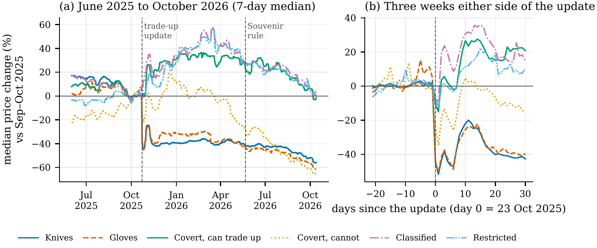
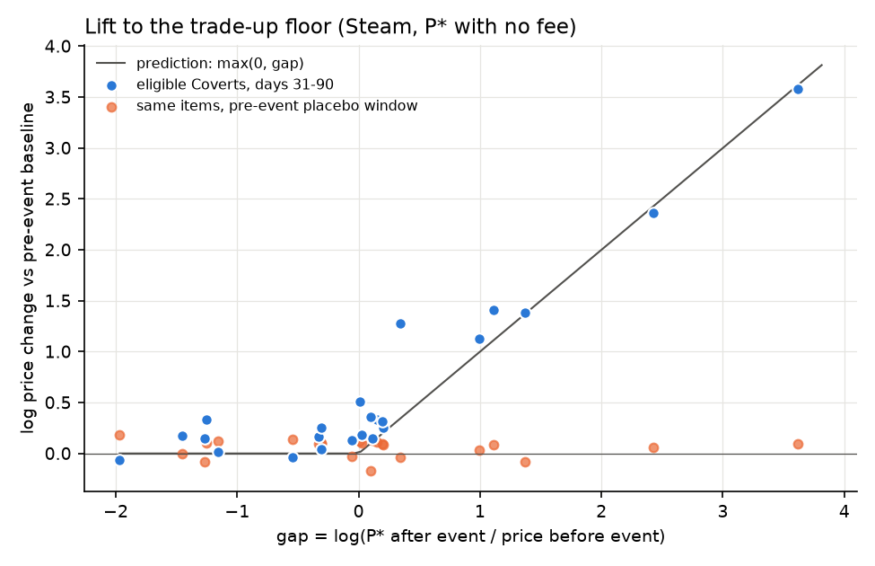

# Counter Strike 2 market crash

On 22 October 2025, Valve changed one rule in Counter-Strike 2: **five Covert (red) weapon skins can now be exchanged for one knife or pair of gloves** from the same case. Knives and gloves are the game's most expensive items, and until then they could only be found by opening cases. Within three days their prices on the Steam marketplace had fallen by almost half, and they have not recovered.

## Summary

This project studies the crash and one of its consequences, using public price data. It asks four questions:

1. **How large was the crash, and did it last?** The median knife lost 46% of its value and the median pair of gloves 47% within three days. Almost a year later both are still more than 40% below their earlier level.
2. **What happened to the skins that could now be traded in?** They rose, very unevenly: the median eligible Covert was up 29% three months later, and the cheapest rose most. Coverts that cannot be traded into knives fell at first.
3. **Why did some rise much more than others?** The rule turned each eligible Covert into a claim on one fifth of a lottery over its case's knives and gloves. That sets a no-arbitrage floor: if five Coverts cost less than the knife or gloves they can become is worth on average, buying five and trading them in pays. Skins priced below their new floor were lifted onto it, by almost exactly the size of the gap.
4. **How fast did prices adjust, and does the floor still hold?** Within about a day, and yes: today no eligible Covert trades clearly below its floor, while skins that cannot use the rule show no such floor.

The most likely reason for the crash is that the rule opened a new supply route into knives and gloves. The data contain prices, not the number of items in circulation, so that explanation is not tested directly.

## The rule and the floor

The trade-up rules come from Valve's patch note ([Steam announcement](https://steamstore-a.akamaihd.net/news/externalpost/steam_community_announcements/1814309641424632)) plus community guides ([SteamDB](https://steamdb.com/en/articles/cs2-trade-up-contract-guide), [CSDelta](https://csdelta.com/tutorials/profitable-cs2-trade-up-guide), [Refrag](https://refrag.gg/blog/cs2-skins-update-trade-ups)). For each eligible Covert, the floor is

> **P\* = (1 − fee) × average price of the knives and gloves in its case's pool / 5**

It is a floor, not a fair price: a Covert below it should be bought up, but nothing pushes a Covert above it back down, because the trade cannot be reversed. `src/parity.py` holds the model.

## Data

Prices come from Skinport's documented public API and from Steam Community Market price histories collected **by hand** (Steam's terms forbid scripts and bots). CSFloat is not used. The repository ships summary tables, model fits and figures, but no raw data and no per-item prices.

## Results

**Knives and gloves crashed.** The fall in the first days was more than twelve times a normal week's movement. Knife prices had been drifting down for a few months before the update, which affects long-run levels but not the first days.

**The floor explains which skins rose.** Each skin's price change after the update lines up with the gap between its new floor and its old price, with a slope close to 1. The same test on a window before the update shows nothing.

**The floor appeared at the update and has held.** Before the update, the cheapest eligible Covert in each case traded at about a sixth of the floor it would later acquire. Since then it has traded a little above it, and dips towards the floor fade within a few days. The floor also passed one rarity down through the older ten-for-one trade-ups.

---

AI assistance was used in this writeup.
