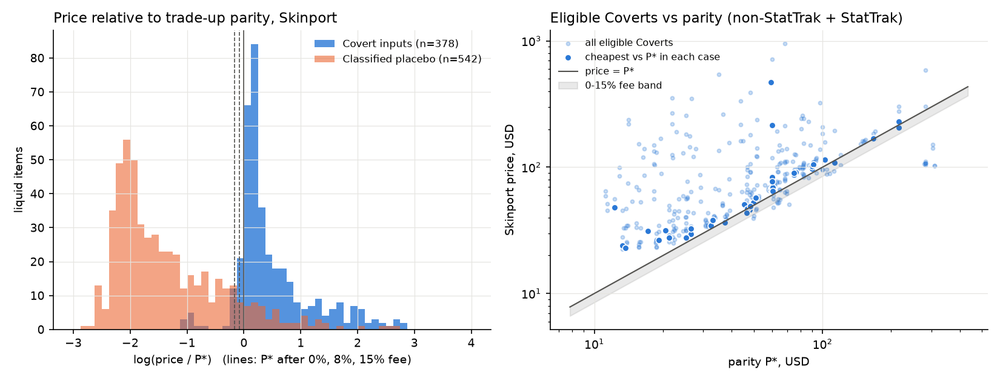
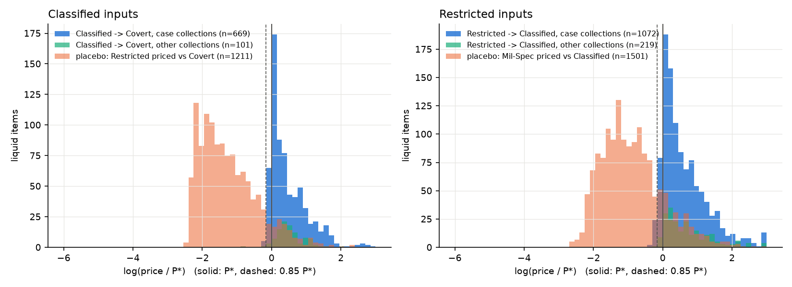
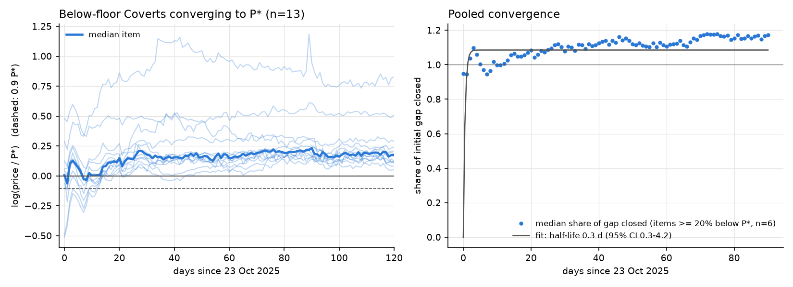
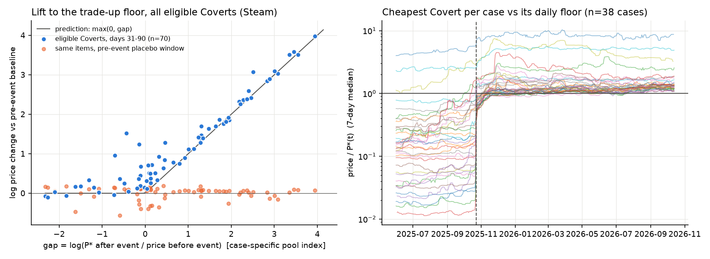
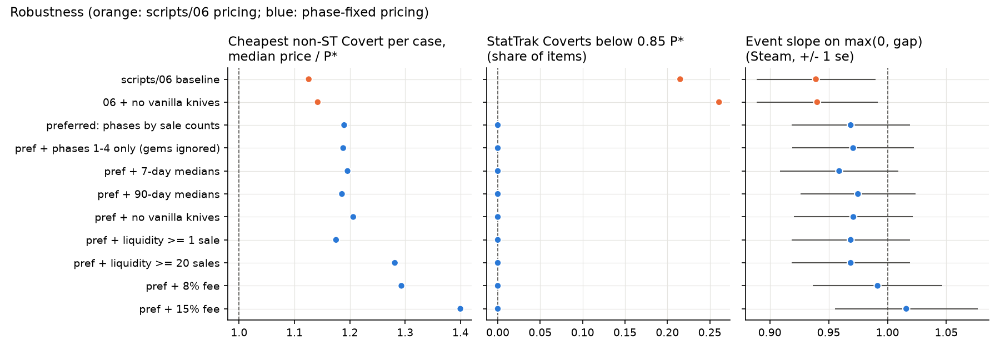
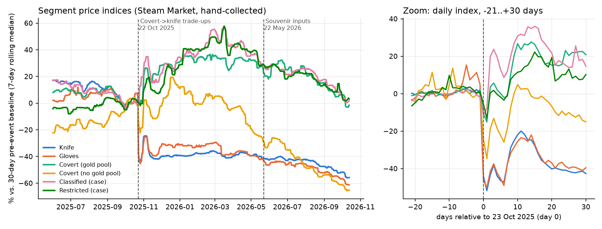

# Trade-up parity in the CS2 skin market

**How a game update created a no-arbitrage price floor.**

On 22 Oct 2025 Valve changed Counter-Strike 2's "Trade Up Contract" so that five Covert (red) weapon skins can be exchanged for one knife or pair of gloves from the collection of one of the inputs. That turns every eligible Covert skin into a claim on one fifth of a lottery over its case's knife/glove pool, and it implies a no-arbitrage floor:

> **P\* = (1 − fee) · E[value of the output] / 5**

This project tests that floor with public data. In the cross-section, eligible Coverts respect it: almost none trades below it, and the cheapest Covert in each case sits close to it. Around the event, items that had been priced below their new floor were lifted onto it, with a slope close to 1 on the size of the gap. Placebo windows and placebo tiers show nothing. Lift happened within about a day. The floor then passed one tier down through the standard 10-for-1 trade-ups. After the event, daily deviations from the floor mean-revert with a half-life of about four days.

Developed with AI assistance (Claude Code).

## The event

* **Patch note** (22 Oct 2025, 23:00 UTC; [Steam announcement 1814309641424632](https://steamstore-a.akamaihd.net/news/externalpost/steam_community_announcements/1814309641424632)): *"5 StatTrak™ Covert items can be exchanged for one StatTrak™ Knife from a collection of one of the items provided; 5 regular Covert items can be exchanged for one regular Knife item or one regular Gloves item from a collection of one of the items provided."*
* Day 0 is **23 Oct 2025**, the first full UTC trading day after the patch. 22 Oct is excluded from the pre-event baseline.
* StatTrak inputs yield StatTrak **knives only**. Coverts from collections with no knife/glove pool (map, armory and some operation collections) cannot be used as inputs.
* A second supply change followed on **22 May 2026**, when Souvenir items became usable in trade-ups. It confounds windows that run past that date.

## Model

`src/parity.py` holds the model.

* **Covert → knife/glove (5-for-1).** Each input picks its own collection's case pool with weight 1/5, and the output is uniform over the items in that pool. For a contract of five copies of one skin and wear, P\* = (1 − fee) · E[output value] / 5.
* **Floats.** The output float is out_min + n · (out_max − out_min), where n is the mean *normalised* input float, (f − in_min)/(in_max − in_min). Each input wear is represented by the midpoint of its float interval.
* **Prices.** Outputs are priced at Skinport 30-day median sales. Doppler-style phases are priced from their own sales, weighted by 90-day sale counts (the preferred specification; see Robustness).
* **Cascade (10-for-1).** Standard contracts take ten inputs of one rarity. A single-collection contract is uniform over the collection's next-tier skins, so P\*_Classified = E[Covert output]/10 and P\*_Restricted = E[Classified output]/10.
* **Rules sources.** Valve's patch note; [SteamDB's trade-up guide](https://steamdb.com/en/articles/cs2-trade-up-contract-guide); [CSDelta](https://csdelta.com/tutorials/profitable-cs2-trade-up-guide); [Refrag](https://refrag.gg/blog/cs2-skins-update-trade-ups). No source says what happens to StatTrak Coverts from glove-only cases. They are given no route, which excludes 56 liquid items across 8 cases.

## Results

### Test 1: cross-section (Skinport, 13 Oct 2026; items with ≥ 5 sales in 30 days)

| group | items | median price/P\* | share < 0.85·P\* | cheapest per case: median price/P\* (IQR) | cases with cheapest in 0.85–1.25 |
|---|---|---|---|---|---|
| Covert inputs, non-StatTrak | 285 | 1.28 | **0%** | **1.13 (1.06–1.25)** | 74% of 43 |
| Covert inputs, StatTrak | 93 | 1.19 | 22% | 1.03 (0.82–1.61) | 25% of 24 |
| Classified placebo (same pools) | 400 | 0.19 | 89% | 0.13 (0.11–0.27) | 0% |

These figures use the baseline pricing in `06`. Under it, no non-StatTrak Covert trades below 0.85·P\*. In logs, the cheapest Covert per case has a slope of 0.81 (se 0.09) on P\* (r = 0.82, n = 43 cases). The apparent StatTrak violations are a pricing artefact. Thin StatTrak knife markets contain stale Doppler gem asks: for example, a $57,344 median ask for a Phase 2 StatTrak Karambit that sells for $1,110–1,730. These asks inflate P\*. With phases priced from their own sales, **0%** of StatTrak Coverts sit below 0.85·P\* (`09_stattrak_diagnosis.py`).



### Test 2: event, "lift to the floor" (Steam, 23 eligible Coverts, days 31–90 vs pre-event baseline)

The parity prediction is that an item's post-event change equals max(0, gap), where gap = log(P\*_post / P_pre). P\* is carried back in time with the median knife/glove Steam index.

| model | slope (se) | R² |
|---|---|---|
| change ~ max(0, gap)  (parity) | **0.94 (0.05)** | 0.94 |
| placebo: pre-event window ~ max(0, gap) | −0.01 (0.02) | 0.00 |
| change ~ log pre-event price  (rival) | −0.73 (0.08) | 0.81 |
| joint: max(0, gap) and log price | 0.71 (0.08); price −0.22 (0.06) | 0.97 |

Thirteen of the 23 items traded below their post-event floor before the event (median 0.81·P\*). Afterwards they sat at 1.14·P\* (IQR 1.04–1.30). For example, the MP9 | Starlight Protector (FT) moved from 0.03·P\* to 0.97·P\*. The results barely change with an 8% or 15% fee on the output.


### Cascade: the floor passes down a tier (`07`, Skinport cross-section)

| inputs → outputs | collections | items | median price/P\* [95% CI] | share < 0.85·P\* | cheapest per collection: median price/P\* | in 0.85–1.25 |
|---|---|---|---|---|---|---|
| Classified → Covert | case | 403 | 1.24 [1.18, 1.32] | 0.7% | **1.02** | 70% of 43 |
| Classified → Covert, StatTrak | case | 266 | 1.57 [1.45, 1.71] | 0% | 1.16 | 59% of 41 |
| Classified → Covert | no knife pool | 90 | 1.60 [1.48, 1.73] | 2% | 1.31 | 29% of 14 |
| Restricted → Classified | case | 610 | 1.48 [1.38, 1.56] | 1% | **1.01** | 60% of 43 |
| Restricted → Classified, StatTrak | case | 462 | 1.59 [1.51, 1.79] | 4% | 1.02 | 46% of 41 |
| placebo: Restricted priced vs Coverts | case | 609 | 0.20 [0.19, 0.23] | 88% | 0.13 | 7% |
| placebo: Mil-Spec priced vs Classifieds | case | 716 | 0.40 [0.37, 0.42] | 83% | 0.24 | 5% |

The 10-for-1 rule **existed before Oct 2025**. On its own, this cross-section therefore shows that the floor binds, not that the knife shock caused it. Because Covert prices carry the knife floor, that floor passes down through the 10-for-1 rule. The event tests below address causation.



### Convergence speed (`08`, Steam daily)

Of the 13 below-floor Coverts, 11 reached ≥ 0.9·P\* within 3 days, most of them on **day 0**. For the six items at least 20% below P\*, the median share of the log gap closed on day 0 was 95%. The fitted pooled half-life is 0.35 days (item bootstrap 0.29–4.2), which is faster than daily data can resolve: adjustment was essentially immediate. The two deepest items, at 0.03·P\* and 0.10·P\*, rose roughly 17× and 5× on day 0 but held ≥ 0.9·P\* only from days 12–13.



### Tier 2: expanded event test and daily-floor dynamics (`11`, 277 hand-collected Steam histories)

**Event test on all eligible Coverts.** P\*(t) is carried back with either one global knife/glove index or a case-specific index built from 2–11 hand-collected pool items per case.

| P\*(t) index | n | slope on max(0, gap) [95% CI items / cases] | R² | placebo slope | rival (log price) R² | joint: parity slope |
|---|---|---|---|---|---|---|
| global | 77 | 0.89 [0.84–0.94 / 0.85–0.92] | 0.93 | 0.01 | 0.71 | 0.79 |
| case-specific | 70 | 0.91 [0.85–0.95 / 0.86–0.94] | 0.93 | 0.01 | 0.80 | 0.75 |

Between 48 and 52 items, depending on the index, were below their post-event floor before the event. Afterwards they sat at a median of 1.12·P\* (IQR 1.01–1.24) with the case-specific index, or 1.10·P\* (IQR 0.98–1.26) with the global index. A slope just below 1 is consistent with attenuation from noise in the estimated P\*.

**Cascade event test.** Classified → Covert: n = 58, of which 31 were below the floor; slope 0.78 [0.71–0.84], R² 0.88, placebo 0.04, rival R² 0.49. Restricted → Classified: n = 38, but only 7 were below the floor, so the test is inconclusive (slope 0.96, CI 0.71–2.39, R² 0.26).

**Daily floor P\*(t), using case pool indices.** These statistics use the Covert closest to its floor in each of 38 cases.
* **Post-event.** The median price is 1.20·P\*(t), and the price is below 0.9·P\*(t) on 1.3% of days (median across cases). Deviations mean-revert with AR(1) φ = 0.83, a half-life of about 4 days (IQR 2.5–7).
* **Jun–Oct 2025, against the counterfactual floor.** The same items sat at a median of 0.17·P\*: before the trade-up existed, there was no floor.
* Items are chosen by how close they are to the floor *today*, so the post-event tightness is partly selected. The pre/post contrast is not.



### Robustness (`10`; one change at a time)

| spec | cheapest non-ST per case: price/P\* | its log slope on P\* | StatTrak share < 0.85 | event slope (se) |
|---|---|---|---|---|
| `06` baseline | 1.13 [1.09, 1.16] | 0.81 [0.66, 0.94] | 21.5% [13, 30] | 0.94 (0.05) [0.89, 1.10] |
| **preferred (phases by sale counts)** | **1.19 [1.13, 1.28]** | **0.83 [0.69, 0.97]** | **0%** | **0.97 (0.05) [0.93, 1.13]** |
| pref, Phases 1–4 only | 1.19 | 0.83 | 0% | 0.97 |
| pref, 7-day / 90-day medians | 1.20 / 1.19 | 0.83 / 0.84 | 0% | 0.96 / 0.98 |
| pref, vanilla knives removed | 1.21 | 0.83 | 0% | 0.97 |
| pref, ≥1 / ≥20 sales | 1.18 / 1.28 | 0.83 / 0.79 | 0% | 0.97 / 0.97 |
| pref, 8% / 15% fee on output | 1.29 / 1.40 | 0.83 / 0.83 | 0% | 0.99 / 1.02 |

Brackets are 95% bootstrap CIs, resampling cases for per-case statistics and items otherwise. Leaving out one case at a time (43 cases) keeps the cheapest-per-case ratio within 1.17–1.19, the slope within 0.81–0.90 and the event slope within 0.96–1.06. The log slope of the cheapest Covert on P\* stays below 1 in every specification: the floor binds more tightly in cheap collections, where Coverts stay about 20% above P\*. That gap is consistent with frictions such as lottery risk, 7-day trade holds and float selection, but none of these is tested here.



### Context: segment price indices (`03`, Steam, 99-item pilot sample)

Knives and gloves fell by a median of about 46% within three days (days 0–2) and did not recover. Measured as the two-week change in the segment index around the event, that is −14 and −13 pre-event weekly standard deviations. Eligible Coverts rose by a median of 29% over days 31–90, very unevenly: across items, Spearman(pre-event price, change) = −0.86, so the cheapest inputs were bid up most. This is the pattern that the parity tests above explain. Knives were already drifting down on Steam before the event (the placebo window [−90, −32] is +13% relative to the baseline). Changes in co-movement between segments are not statistically detectable with 26 weeks on each side (`results/steam/comovement_changes.csv`).



## Caveats and limitations

* **Small event samples.** Test 2 uses n = 23 (77 in Tier 2). The Restricted cascade is uninformative.
* **P\* is backcast.** P\* is computed from 13 Oct 2026 Skinport prices and carried back to the event window with Steam knife/glove indices, global or case-specific. Noise in that index attenuates the slopes.
* **Rules partly from third parties.** Uniform pool draws, float normalisation and the StatTrak rule come from Valve's patch note plus community guides. Valve publishes no Doppler phase odds, so phases are weighted by Skinport sale counts and the result is bracketed with "Phases 1–4 only".
* **Steam prices.** These are in non-withdrawable wallet funds (the collecting account's currency, GBP here), carry about a 15% fee and are capped per item. Knives and gloves at or near the cap before the event are excluded. All event statistics are log changes within an item, so the currency and the level premium cancel.
* **Composition noise.** Daily Steam medians mix floats, patterns and stickers. A quality-adjusted index would be cleaner.
* **Selection.** The pilot sample was chosen on liquidity on 13 Oct 2026, which over-samples items that became liquid because of the event. There is no clean untreated control inside CS2, because every case-collection tier is linked to the treated tiers by trade-ups.
* **Confounders.** These include new case releases, drop-pool changes, tournaments and the 22 May 2026 Souvenir trade-up change.

## Data

The repository ships **no raw data**: `data/` is git-ignored. It contains only derived tables (`results/`) and figures.

| source | used for | how it is collected |
|---|---|---|
| [Skinport API](https://docs.skinport.com/) `GET /v1/items`, `GET /v1/sales/history` | current prices, 7/30/90-day sale medians and volumes, listing quantities | `scripts/collect_snapshot.py` (documented public API, no key, 2 requests; the limit is 8 per 5 minutes) |
| Steam Community Market price history | daily price histories for the event tests | **by hand**, in your own logged-in browser, using the helper pages in `tools/`. The Steam Subscriber Agreement (s. 4.C) forbids scripts and bots, so no code here contacts Steam |
| [ByMykel/CSGO-API](https://github.com/ByMykel/CSGO-API) item schema (MIT) | rarity, collections, cases, float ranges, knife/glove pools | cached to `data/raw/bymykel/skins.json` by `collect_snapshot.py` |

CSFloat's terms do not permit automated access, so it is not used.

**Collecting the Steam histories by hand.**
1. Open `tools/steam_collect.html` (the 99-item pilot sample) and `tools/steam_collect_tier2.html` (178 further items) in a browser where you are logged in to Steam. To rebuild the pages, run `scripts/04_make_steam_helper.py` (and `--list results/collection_lists/tier2.csv --name tier2`).
2. For each item, open the link, copy the JSON that Steam shows and paste it into the page. The page saves progress in browser storage.
3. Click **Download data** and move the downloaded JSON bundle(s) into `data/manual_steam/`. `05_parse_steam_manual.py` merges all bundles, and a later capture of an item replaces an earlier one. Use this to fix a bad paste.

**Exact reproduction.** The published numbers use the Skinport snapshot taken at 17:09 UTC on 13 Oct 2026. Its path is pinned in `src/parity_inputs.py` as `data/snapshots/2026-10-13/1709_skinport_sales.parquet` (with a matching `_items` file), and the Steam histories were collected on the same day. Skinport serves only current data, so a fresh clone cannot re-download that snapshot. If the pinned file is absent, scripts 06–11 use the latest snapshot under `data/snapshots/`, or the file named by the environment variable `CS2_SKINPORT_SNAPSHOT`. The pipeline then runs end to end, but the cross-sectional numbers will reflect the new date. The frozen sample (`results/sample.csv`) and the Tier 2 list (`results/collection_lists/tier2.csv`) are shipped, so the same items are collected.

## Reproduce

```bash
git clone <this repo> cs2-tradeup-parity && cd cs2-tradeup-parity
conda env create -f environment.yml && conda activate cs2-tradeup-parity

# 0. Data
python scripts/collect_snapshot.py        # Skinport snapshot -> data/snapshots/<date>/, plus the item schema
#    then collect the Steam histories by hand (see "Data") into data/manual_steam/

# 1. Steam panel and segment event study
python scripts/05_parse_steam_manual.py   # data/manual_steam/*.json -> data/processed/panel_steam.parquet
python scripts/03_event_study.py          # -> results/steam/, figures/steam/

# 2. Trade-up parity (local files only, no network)
python scripts/06_parity_test.py          # Tests 1-2, Covert -> knife/glove   -> results/parity/, figures/parity/
python scripts/07_parity_cascade.py       # 10-for-1 cascade + placebos
python scripts/08_parity_convergence.py   # days to 0.9 P*, half-life
python scripts/09_stattrak_diagnosis.py   # the StatTrak pricing artefact
python scripts/10_parity_robustness.py    # one-at-a-time robustness, bootstrap, leave-one-case-out (~1 min)
python scripts/11_tier2_parity.py         # Tier 2: expanded event test, cascade event, daily floor dynamics
```

Optional: `scripts/02_select_sample.py` reports the frozen sample, and `--reselect` redraws it from current Skinport volumes. `scripts/04b_make_tier2_lists.py` rebuilds the Tier 2 collection list; it skips items already in the Steam panel, so it will not reproduce the shipped list once those items are collected.

With the original 13 Oct 2026 snapshot and Steam bundles in `data/`, scripts 05, 03 and 06–11 reproduce every CSV in `results/` and every figure byte for byte.

## Layout

```
src/http_cache.py      cached, throttled GET (JSON only; responses treated as untrusted data)
src/sources.py         Skinport API and ByMykel schema wrappers
src/catalog.py         segment definitions and liquid-sample selection
src/analysis.py        event windows, segment indices, bootstrap CIs, co-movement blocks
src/parity.py          trade-up model: pools, P*, cascade, phase-robust prices
src/parity_inputs.py   shared local inputs for 06-11 (pinned snapshot, Steam panel)
scripts/               02 sample, 03 event study, 04/04b/05 Steam by hand, 06-11 parity,
                       collect_snapshot (Skinport)
tools/                 hand-collection helper pages (template + generated pages)
results/               derived tables; figures/ PNGs
data/                  snapshots, schema cache, Steam bundles, panel (git-ignored, not shipped)
```
